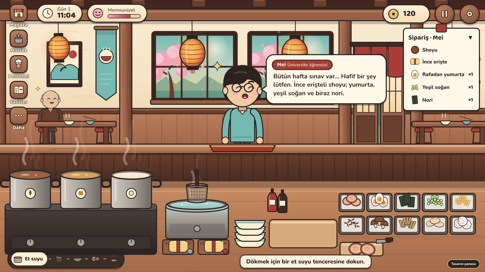

# Ramen Stories

A cozy 2D restaurant simulation for iOS and Android: a small neighborhood ramen shop with real hands-on cooking,
returning customers with stories, and a kitchen that visibly grows with you.

**Current phase: Phase 1 — Design Foundation (delivered).** Phase 2 (Unity playable cooking prototype) is next.
See [`docs/PHASE-1-REPORT.md`](docs/PHASE-1-REPORT.md) for exactly what exists, what was tested and what doesn't exist yet.



## What's in this folder
| Path | Contents |
|---|---|
| `docs/01-art-style-guide.md` | Palette, line, light, scale, sorting layers, characters, food, UI, motion rules |
| `docs/02-screen-specifications.md` | The 10 required screens: dimensions, layers, positions, interactions, animation, navigation, scaling |
| `docs/03-unity-architecture.md` | Unity 6 project blueprint, ScriptableObjects, systems map, Phase 2 checklist |
| `docs/PHASE-1-REPORT.md` | Deliverables, test results, known issues, next steps |
| `art/` | 69 layered vector assets + 9 characters (3 views, 5 expressions, talking, sheet), `manifest.json` |
| `mockups/` | Screenshots of every screen (16:9, 19.5:9 phone, 4:3 tablet; TR + EN) |
| `tests/` | Node unit tests (order evaluation, localization parity, asset integrity) |
| `tools/` | Static server, asset exporter, screenshot renderer, end-to-end playtest |

The interactive mockup itself lives in [`public/ramen-stories/`](../public/ramen-stories/) so the existing
Express-on-Vercel app serves it at **`/ramen-stories/`**.

## Run it
```bash
npm run ramen:serve
```
Open http://localhost:4173/ramen-stories/ in a landscape window. Use the **Design board** (bottom-right) to switch
between the 10 screens, TR/EN, sound and reduced motion. URLs are linkable: `/ramen-stories/?lang=en#prep`.

```bash
npm run test:ramen
```
```bash
npm run ramen:playtest -- http://localhost:4173/ramen-stories/ 844x390
```
```bash
npm run ramen:export
```
(The playtest and screenshot tools use the Playwright + Chromium preinstalled in this environment. Elsewhere,
install Playwright first.)
